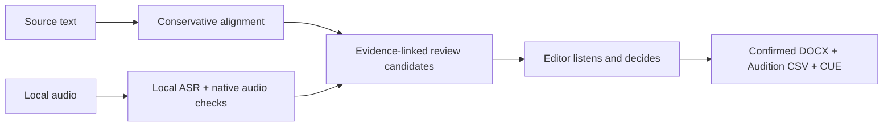

# Readback Sentinel

<p align="center">
  <strong>Local, evidence-first quality triage for narrated audio</strong><br />
  A practical open-source toolkit for finding review-worthy text and technical risks — without pretending that an ASR model can judge a narrator.
</p>

<p align="center">
  <a href="#what-it-is">What it is</a> ·
  <a href="#quick-start">Quick start</a> ·
  <a href="#workflow">Workflow</a> ·
  <a href="#safety-contract">Safety contract</a> ·
  <a href="#project-status">Status</a> ·
  <a href="#contributing">Contributing</a>
</p>

<p align="center">
  
  
  
  
</p>

---

## What it is

**Readback Sentinel** is a local, headless Python toolkit for the first-pass review of audiobook narration and other scripted voice recordings.

It combines local speech recognition, conservative text alignment and native audio checks to produce a **review package**:

- timestamped candidates where recognised speech and the printed source diverge;
- clipping, silence and basic acoustic observations;
- optional glossary candidates;
- a preliminary PDF, JSON, DOCX, Audition-compatible CSV and standard CUE listening map;
- a separate confirmation path that produces narrator-facing files and a confirmation-only CUE map from human-confirmed candidates.

It is designed for editors, producers and audio teams who want a shorter, evidence-linked listening queue — **not** an automated verdict on a narrator’s work.

> [!IMPORTANT]
> A candidate is not a defect. ASR confidence, text similarity, F0 and amplitude metrics are evidence signals, not proof that a narrator made a mistake.

## The problem it addresses

Reviewing long spoken recordings against a source text is costly. Yet blindly trusting speech-to-text is unsafe: uncommon names, terms, numbers and expressive delivery can all cause false flags.

Readback Sentinel narrows the manual review surface:



The product boundary is deliberate: machines locate things worth checking; people decide whether something is actually wrong.

## What it does today

| Area | Current behavior |
|---|---|
| **Text localisation** | Finds a securely aligned read fragment inside PDF, DOCX or UTF-8 TXT source material. Ambiguous alignment fails closed instead of comparing against the wrong passage. |
| **Text comparison** | Emits `REVIEW` candidates for additions, omissions and substitutions in the aligned scope. It does not label them narrator errors automatically. |
| **Glossary support** | Creates conservative review candidates for whole single- and multi-word glossary variants. It does not prove phonetic correctness. |
| **Technical checks** | Checks source channels for clipping, reports quiet intervals and records diagnostic acoustic values. |
| **Prosody** | Reports diagnostic F0 observations. It does not claim that a performance is expressive or artistically correct. |
| **Review artifacts** | Creates preliminary PDF, JSON, DOCX, CSV and CUE listening-map outputs; then creates narrator-facing outputs and an Audition/CUE map only from a bound human confirmation. |
| **Run integrity** | Uses isolated run folders, manifests, input hashes and review bindings so confirmation cannot silently target another analysis attempt. |

## What it deliberately does **not** claim

- It does **not** establish that a narrator is correct, expressive, monotone, tired or “good”.
- It does **not** equate ASR confidence or string similarity with truth.
- It does **not** measure real-world precision, recall or false-positive rate without a labelled evaluation set.
- It does **not** infer a production noise standard from an amplitude percentile.
- It does **not** implement comparison against an approved reference performance yet; `--reference` is rejected before analysis.
- It does **not** include a server, queue, dashboard, upload service or deployment recipe.

See [Project status](#project-status) for the complete scope boundary.

## Quick start

Clone the repository, then inspect prerequisites before any installation:

```bash
git clone https://github.com/pavelnasuta/readback-sentinel.git
cd readback-sentinel
python3 scripts/bootstrap.py check --json
```

Read [INSTALL.md](INSTALL.md) for the receipt contract, manual macOS/Homebrew, Ubuntu/Debian, and Windows/winget prerequisites, explicit local-model consent, and privacy boundary. When the check is ready, the documented bootstrap commands synchronize the locked development environment and optionally prepare a model.

### Prerequisites

The bootstrap check reports whether the local environment has Python 3.11+, `uv`, and `ffmpeg`. A local `faster-whisper` model is required only for actual analysis and is prepared only with an explicit `--model` request.

```bash
# Engineering verification: synthetic tests only, no customer files or model download.
uv run pytest -q
```

### Analyse one recording

Use a new output directory outside the source-material folder. Customer media, books, transcripts, glossaries and run outputs must remain outside Git.

```bash
uv run python scripts/run_qc.py \
  --audio "/absolute/path/recording.wav" \
  --text "/absolute/path/source.pdf" \
  --output "/absolute/path/qc_runs" \
  --model small \
  --tag chapter_01
```

Supported input formats:

| Input | Formats |
|---|---|
| Audio | WAV, MP3, FLAC — MP3/FLAC require `ffmpeg` |
| Source text | PDF, DOCX, UTF-8 TXT |
| Glossary | Optional JSON array of `{term, transcription, notes}` |

Each attempt writes its own folder:

```text
qc_runs/
└── analysis_chapter_01_<run_id>/
    ├── run_manifest_chapter_01.json
    ├── report_chapter_01.json
    ├── report_chapter_01.pdf
    ├── triage_chapter_01.docx
    ├── triage_markers_chapter_01.csv
    ├── triage_markers_chapter_01.cue
    ├── transcript_chapter_01.txt
    ├── transcript_segments_chapter_01.json
    └── prosody_chapter_01.png
```

`COMPLETED` means that the computation completed; it does **not** mean that the recording was accepted.

## Workflow

### 1. Analyse locally

The first run creates a reviewer package. It never authorises a narrator-facing correction list on its own.

### 2. Review the candidates

An editor listens to each candidate in the PDF or JSON report and decides whether it is:

- confirmed;
- a false ASR flag;
- an allowed variant;
- unclear.

### 3. Export only confirmed items

Create a confirmation file from the exact `review_binding` in the reviewed report:

```json
{
  "review_binding": "<exact value from report JSON>",
  "confirmed_flag_ids": ["flag_0000", "ac_5000"]
}
```

Then run confirmation mode:

```bash
uv run python scripts/run_qc.py \
  --audio "/absolute/path/recording.wav" \
  --text "/absolute/path/source.pdf" \
  --output "/absolute/path/qc_runs" \
  --tag chapter_01 \
  --review-report "/absolute/path/analysis_chapter_01_<run_id>/report_chapter_01.json" \
  --confirmed-flags "/absolute/path/confirmed_chapter_01.json"
```

This mode does not rerun ASR. It verifies the source hashes, report binding and candidate IDs, then creates a fresh confirmation directory containing only the confirmed DOCX, CSV and CUE outputs. The CUE files are listening maps: preliminary CUEs contain only `CRITICAL`/`REVIEW` candidates and retain the human-review warning, while confirmation CUEs contain only explicitly confirmed IDs. Neither CUE includes transcript, printed-book text or free-form candidate descriptions.

## Safety contract

Readback Sentinel follows four non-negotiable rules:

1. **No customer content in Git.** Audio, books, transcripts, glossaries, vectors and generated customer reports are ignored and must remain private.
2. **Fail closed on uncertain alignment.** If the system cannot securely locate the spoken fragment in the source, it returns `ALIGNMENT_FAILED` rather than inventing a diff.
3. **Human confirmation before external action.** Narrator-facing DOCX plus final Audition CSV/CUE maps are derived only from an explicitly reviewed, bound snapshot.
4. **Unknown is not clean.** A missing candidate, unavailable method or incomplete coverage never becomes an automatic “no defect” conclusion.

For engineering contributors, the detailed rules live in [AGENTS.md](AGENTS.md).

## Project status

This repository is a public **preview of a local QC core**. The test suite currently verifies synthetic behavior and safety contracts. It is not a claim of operational readiness on arbitrary real recordings.

| Capability | Status |
|---|---|
| Synthetic regression suite | Available |
| Local single-file triage | Available |
| Human-bound confirmation export | Available |
| Representative natural-audio accuracy evaluation | Not measured |
| Calibrated noise / artistic-performance decisions | Not available |
| Approved-reference performance comparison | Not implemented |
| Long-file resource qualification | Not measured |
| Linux/server deployment | Not implemented |
| Queue, dashboard, Telegram/Drive integration | Out of scope |

## Repository map

```text
readback-sentinel/
├── audiobook_qc/     # Core alignment, ASR, acoustic and export modules
├── configs/          # Versioned thresholds and policy
├── scripts/          # CLI entry point
├── tests/            # Synthetic regression and safety contracts
├── docs/             # Architecture, development and release documentation
├── eval/             # Public schemas and examples — not client media
├── SKILL.md          # Hermes skill entry point
└── AGENTS.md         # Contribution and safety rules
```

## Documentation

- [Contribution guide](CONTRIBUTING.md)
- [Security and privacy policy](SECURITY.md)
- [Development workflow](docs/DEVELOPMENT.md)
- [Technical pipeline specification](references/pipeline_spec.md)
- [Release history](CHANGELOG.md)
- [Architecture overview](docs/ARCHITECTURE.md)

## Contributing

Contributions are welcome when they improve evidence quality without turning heuristic output into a verdict.

Before opening a pull request:

```bash
uv sync --dev
uv run pytest -q
```

Read [CONTRIBUTING.md](CONTRIBUTING.md) and [AGENTS.md](AGENTS.md). Never attach customer materials, proprietary text, real transcripts or credentials to an issue, commit or pull request.

## License

MIT — see [LICENSE](LICENSE).

## Origin

Readback Sentinel began as an internal experiment in local narration QA. The public project exists to make the engineering approach inspectable: conservative evidence, local processing and a human decision gate.
