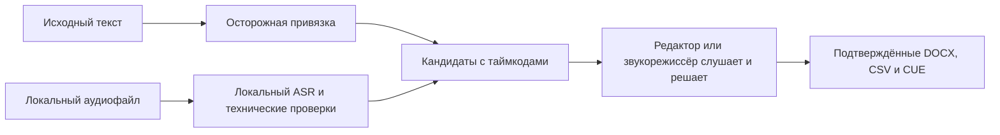

# Readback Sentinel

> **Локальный инструмент первичного контроля начитки по исходному тексту.**
> Он находит места, которые стоит переслушать человеку, — но не выносит автоматический вердикт о качестве работы диктора.

[](https://www.python.org/)
[](LICENSE)
[](#конфиденциальность-и-безопасность)
[](#главное-правило)

**[Быстрый старт](#быстрый-старт) · [Как работает](#как-это-работает) · [Артефакты](#что-получается-на-выходе) · [Подтверждение](#подтверждение-редактором) · [Ограничения](#чего-инструмент-не-делает) · [Документация](#документация)**

---

## Зачем нужен Readback Sentinel

Сверять длинную аудиозапись с книгой или сценарием вручную долго. Но слепо доверять ASR небезопасно: имена, термины, числа, интонация и темп речи регулярно создают ложные срабатывания.

Readback Sentinel сужает зону ручной проверки:

1. локально распознаёт запись;
2. осторожно привязывает распознанный фрагмент к PDF, DOCX или TXT;
3. формирует текстовые, глоссарные и технические кандидаты с таймкодами;
4. отдаёт редактору и звукорежиссёру материалы для прослушивания;
5. создаёт финальные редакторские артефакты только из явно подтверждённых пунктов.

Инструмент рассчитан на редактора, звукорежиссёра, продюсера и команду производства аудиокниг, которым нужна проверяемая очередь для прослушивания, а не «оценка выразительности нейросетью».

## Главное правило

> **Кандидат не равен ошибке.**
> Расхождение ASR с книгой, низкая уверенность распознавания, F0, громкость или другой автоматический сигнал — повод проверить участок, а не доказательство брака начитки.

Если текст нельзя надёжно сопоставить с записью, инструмент возвращает `ALIGNMENT_FAILED` и **не придумывает** текстовые расхождения. Неполное покрытие, недоступный модуль или сбой анализа никогда не означают «всё чисто» и никогда не являются виной диктора.

## Что умеет сейчас

| Задача | Что делает |
|---|---|
| **Привязка к исходнику** | Ищет прочитанный фрагмент в PDF, DOCX или UTF-8 TXT. Неоднозначная привязка останавливает текстовое сравнение. |
| **Сверка текста** | Формирует `REVIEW`-кандидаты для добавлений, пропусков и замен в надёжно найденном окне. |
| **Глоссарий** | Ищет целые одно- и многословные варианты терминов как кандидаты на прослушивание. |
| **Технические сигналы** | Отмечает клиппинг, тихие интервалы и диагностические акустические наблюдения. |
| **Просодика** | Даёт диагностические наблюдения F0; не оценивает художественную выразительность. |
| **Контроль целостности** | Хранит изолированные попытки, манифесты, хеши входов и `review_binding`, чтобы подтверждение не применилось к другому отчёту. |
| **Локальная установка** | Помогает проверить и подготовить зависимости на macOS, Ubuntu/Debian и Windows. |

## Быстрый старт

### 1. Склонируйте проект и проверьте окружение

```bash
git clone https://github.com/pavelnasuta/readback-sentinel.git
cd readback-sentinel
python3 scripts/bootstrap.py check --json
```

`check` ничего не устанавливает и ничего не скачивает. Он сообщает, готовы ли Python 3.11+, `uv`, `ffmpeg`, конфигурация проекта и lockfile.

Если receipt вернул `ACTION_REQUIRED`, сначала выполните указанное ручное действие и снова запустите проверку. Это безопасная остановка, а не частичный успех.

### 2. Явно подтвердите установку зависимостей

```bash
# Зависимости проекта — без модели.
python3 scripts/bootstrap.py install --yes --skip-model --json

# Только если нужна локальная ASR-модель.
python3 scripts/bootstrap.py install --yes --model small --json
```

Bootstrap не запускает `sudo` или UAC, не выполняет текст ручных инструкций и не скачивает модель без явного `--model tiny|base|small`. Подробности, включая macOS/Homebrew, Ubuntu/Debian и Windows/winget, — в [INSTALL.md](INSTALL.md).

### 3. Запустите анализ одной записи

Исходные материалы и результаты храните **вне Git** и в отдельной папке результатов.

```bash
uv run python scripts/run_qc.py \
  --audio "/путь/к/записи.wav" \
  --text "/путь/к/исходнику.pdf" \
  --output "/путь/к/qc_runs" \
  --model small \
  --tag chapter_01
```

| Вход | Форматы |
|---|---|
| Аудио | WAV, MP3, FLAC; для MP3/FLAC нужен `ffmpeg` |
| Исходный текст | PDF, DOCX, UTF-8 TXT |
| Глоссарий | Необязательный JSON-массив `{term, transcription, notes}` |

## Как это работает



### 1. Предварительный анализ

Создаётся отдельная папка `analysis_<tag>_<run_id>/`. Повторный запуск не перезаписывает предыдущую попытку.

### 2. Ручная проверка

Редактор слушает каждый кандидат и решает, что это:

- подтверждённое замечание;
- ложное срабатывание ASR;
- допустимый вариант;
- неясный случай.

### 3. Подтверждённый экспорт

Только после ручной проверки создаётся файл с подтверждёнными ID, привязанный к точному снимку отчёта:

```json
{
  "review_binding": "<точное значение из report_*.json>",
  "confirmed_flag_ids": ["flag_0000", "ac_5000"]
}
```

```bash
uv run python scripts/run_qc.py \
  --audio "/путь/к/записи.wav" \
  --text "/путь/к/исходнику.pdf" \
  --output "/путь/к/qc_runs" \
  --tag chapter_01 \
  --review-report "/путь/к/analysis_<run_id>/report_chapter_01.json" \
  --confirmed-flags "/путь/к/confirmed_chapter_01.json"
```

В этом режиме ASR не запускается повторно: инструмент проверяет хеши входов, `review_binding` и ID, а затем создаёт новую папку подтверждения.

## Что получается на выходе

```text
qc_runs/
└── analysis_chapter_01_<run_id>/
    ├── run_manifest_chapter_01.json
    ├── report_chapter_01.json
    ├── report_chapter_01.pdf
    ├── triage_chapter_01.docx
    ├── triage_markers_chapter_01.csv
    ├── triage_markers_chapter_01.cue
    ├── transcript_chapter_01.txt
    ├── transcript_segments_chapter_01.json
    └── prosody_chapter_01.png
```

| Артефакт | Для чего нужен |
|---|---|
| `report_*.json` / `report_*.pdf` | Предварительный отчёт и данные для редактора. |
| `triage_*.docx` | Список кандидатов для разбора. |
| `triage_markers_*.csv` | Маркеры для совместимого аудиоредактора. |
| `triage_markers_*.cue` | Карта точек прослушивания для звукорежиссёра. Содержит только `CRITICAL` и `REVIEW`. |
| `run_manifest_*.json` | Состояние попытки, входные хеши, версии и список артефактов. |
| Транскрипты и график просодики | Вспомогательная локальная evidence-база, не готовый вердикт. |

### CUE для звукорежиссёра

`.cue` — не перечень доказанных ошибок, а карта переходов по записи.

- Предварительный `triage_markers_<tag>.cue` содержит только `CRITICAL` и `REVIEW` и явно помечен как требующий проверки человеком.
- Подтверждённый `audition_markers_<tag>.cue` создаётся только из ID, которые редактор подтвердил вручную.
- `STT_ARTIFACT`, текст книги, транскрипт и свободные описания кандидатов в CUE не попадают.

## Конфиденциальность и безопасность

- Аудио, книги, транскрипты, глоссарии, векторы, результаты QC и персональные данные не должны попадать в GitHub.
- Readback Sentinel не загружает материалы в облако и не содержит upload-сервиса.
- Bootstrap receipt не сохраняет stdout/stderr команд, environment, аргументы команд или приватные пути.
- Модель загружается только по явной команде пользователя.
- `COMPLETED` означает, что вычисление завершилось. Это **не** означает, что запись принята.
- `PARTIAL`, `FAILED`, неизвестное покрытие или отсутствие кандидатов не означают ни вины диктора, ни автоматического одобрения.

## Чего инструмент не делает

Readback Sentinel намеренно **не**:

- подтверждает, что диктор прочитал текст дословно;
- оценивает художественную выразительность, «монотонность», усталость или общее качество исполнения;
- превращает ASR confidence или похожесть строк в истину;
- измеряет реальную precision/recall/FPR без размеченного eval-набора;
- устанавливает стандарт шума по одному уровню амплитуды;
- сравнивает запись с эталонной начиткой — `--reference` пока зарезервирован и отклоняется до анализа;
- предоставляет сервер, очередь, дашборд, загрузку файлов или автоматическую отправку замечаний диктору.

## Текущий статус

Это публичный preview локального QC-ядра. Тесты проверяют синтетические сценарии и safety-контракты, но не доказывают точность на произвольных реальных записях.

| Возможность | Статус |
|---|---|
| Синтетические регрессионные тесты | Доступно |
| Локальный анализ одной записи | Доступно |
| Экспорт после ручного подтверждения | Доступно |
| `.cue`-карты для предварительных и подтверждённых точек | Доступно |
| Оценка качества на репрезентативных живых данных | Не измерена |
| Калиброванная оценка шума и художественного исполнения | Недоступна |
| Сравнение с утверждённой эталонной начиткой | Не реализовано |
| Квалификация длинных файлов и server-ready режим | Не измерены |
| Очередь, дашборд, Telegram/Drive-интеграции | Вне scope |

## Инструкции для агентов

- [AGENTS.md](AGENTS.md) — общие правила разработки и безопасности для coding-агентов и контрибьюторов.
- [SKILL.md](SKILL.md) — операционная инструкция для Hermes Agent: подготовка окружения, запуск и границы выводов.
- [CONTRIBUTING.md](CONTRIBUTING.md) — правила для вкладов в проект.

`AGENTS.md` — широко поддерживаемая, но не универсальная конвенция. Если ваш агент не читает `AGENTS.md` автоматически, явно дайте ему команду начать с этого файла. Не дублируйте правила в случайные agent-specific файлы: источник правды должен оставаться один.

## Документация

- [Установка и bootstrap](INSTALL.md)
- [Архитектура](docs/ARCHITECTURE.md)
- [Разработка](docs/DEVELOPMENT.md)
- [Техническая спецификация pipeline](references/pipeline_spec.md)
- [Правила безопасности](SECURITY.md)
- [История изменений](CHANGELOG.md)
- [Релиз v0.5.0](docs/releases/v0.5.0.md)

## Как внести вклад

Перед pull request:

```bash
uv sync --dev
uv run pytest -q
```

Не добавляйте в issue, commit или PR клиентские материалы, конфиденциальные тексты, реальные транскрипты, отчёты или учётные данные. Подробности — в [CONTRIBUTING.md](CONTRIBUTING.md) и [AGENTS.md](AGENTS.md).

## Лицензия

[MIT](LICENSE).
