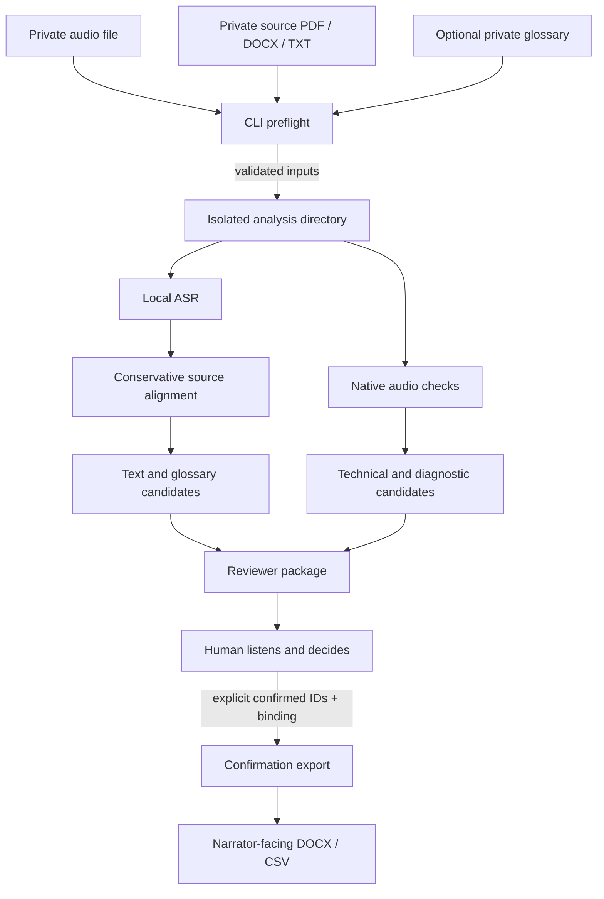

# Architecture overview

> Current scope: local, single-recording editorial triage. The project does not implement a hosted service, queue, dashboard or automatic acceptance workflow.

## Runtime path

## Modules

| Module | Responsibility | Boundary |
|---|---|---|
| `scripts/run_qc.py` | CLI, input validation, isolated run lifecycle | No hidden cloud upload or overwrite of an existing attempt |
| `audiobook_qc/asr.py` | Local faster-whisper transcription | Recognition output remains evidence, never ground truth |
| `audiobook_qc/alignment.py` | Securely localises the read fragment in source text | Ambiguous alignment stops text diff |
| `audiobook_qc/text_analysis.py` | Timestamped text and glossary review candidates | Candidates remain reviewer-facing |
| `audiobook_qc/acoustics.py` | Native clipping, silence and diagnostic measures | It does not claim calibrated noise or production acceptance |
| `audiobook_qc/prosody.py` | Diagnostic F0 observations | It does not assess artistic expressiveness |
| `audiobook_qc/exports.py` | Preliminary and confirmation-only outputs | Narrator-facing exports require a reviewed binding |
| `audiobook_qc/manifest.py` | Input/config hashes and run provenance | Each attempt is immutable after completion |

## Trust boundaries

- **Private inputs:** audio, books, scripts, transcripts, glossaries and editorial decisions stay on the operator’s machine.
- **Analysis package:** a preliminary package may be used by an editor, but is not permission to contact a narrator.
- **Confirmation package:** created only from explicitly confirmed candidate IDs bound to one report snapshot.
- **Public repository:** contains code, synthetic tests and schema examples only. It is not an archive for production evidence.

## Failure behavior

| Condition | Required behavior |
|---|---|
| Input is missing or unsupported | Reject before analysis and do not imply a clean result |
| Source alignment is ambiguous | Emit `ALIGNMENT_FAILED`; do not create text-diff candidates |
| Analysis crashes | Persist `FAILED` manifest for that isolated attempt; do not treat partial files as success |
| Human binding does not match report or inputs | Reject confirmation; do not create narrator-facing outputs |
| Candidate is absent | Do not interpret absence as proof that there is no defect |

## Deliberately absent components

No queue, database, user management, upload endpoint, cloud adapter, notification bot or server deployment is present in this repository. Those would require a separate security model, persistence design, operational evaluation and explicit product decision.
